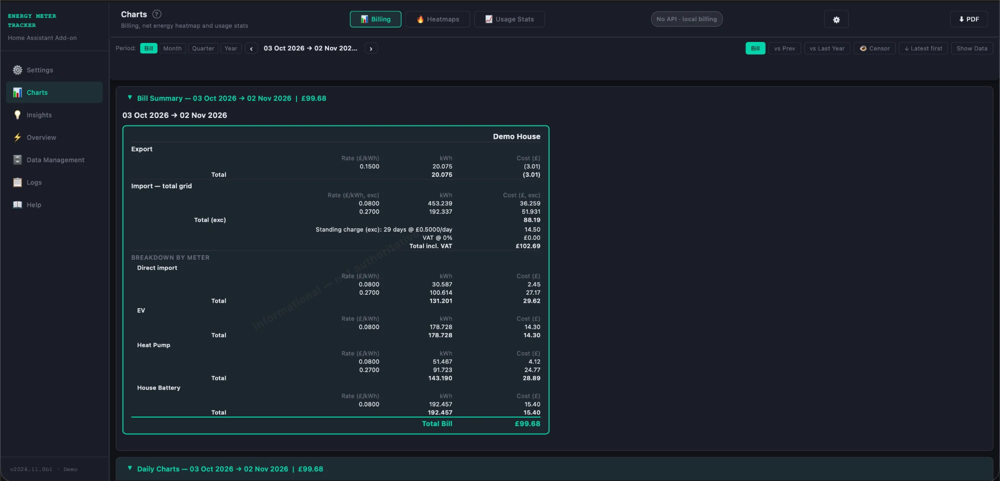
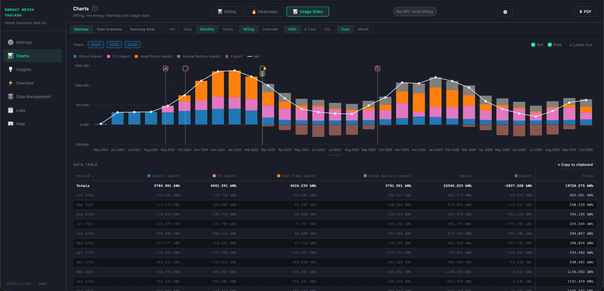
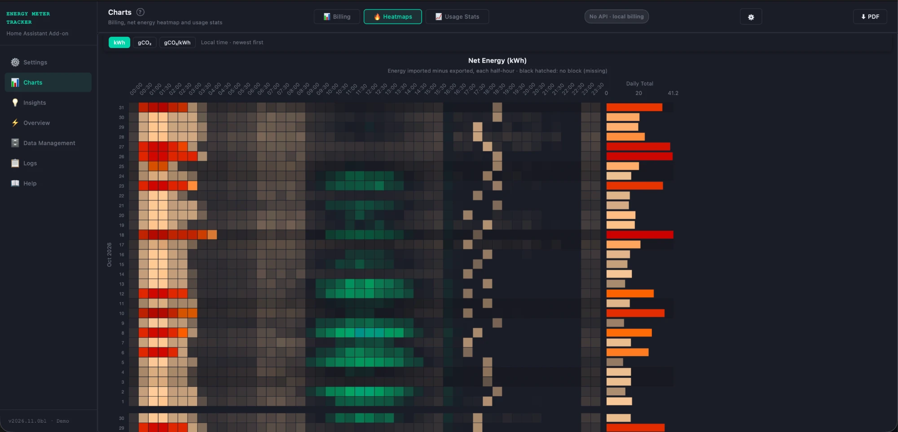
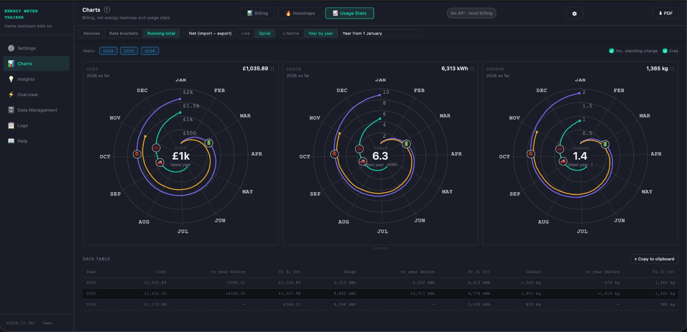

# EMT — Energy Meter Tracker

[](https://github.com/RGx01/EMT/releases)

[](LICENSE)


A Home Assistant add-on for Octopus Energy accounts: each half-hour's electricity cost, your devices
(a car, a battery, a heat pump) split out of the meter, Intelligent Octopus Go's smart charging and
its 6-hour cap, and your history settled against Octopus's own bill.

> **Beta.** EMT is being tested by a few invited people before its first release. Expect rough
> edges; please report them — see [BETA.md](BETA.md).

EMT is the successor to [Energy Meter Tracker v4](https://github.com/RGx01/energy-meter-tracker-addon).
It is a **new add-on with its own slug** (`emt`), not an upgrade: it installs beside v4, runs beside
it for as long as you like, and can bring v4's history across from a v4 backup.

| | |
|---|---|
|  |  |
|  |  |

*A made-up household — `.build/demo_db.py`.*

## Requirements

- **Home Assistant OS or Supervised** (the add-on), or **any Docker host** beside a Home Assistant
  (see [Standalone Docker](#standalone-docker)).
- **A 64-bit machine** — `aarch64` (a Raspberry Pi on a 64-bit OS) or `amd64`. 32-bit is not built.
- **Somewhere for your readings to come from**, one of:
  - a **local meter reader** (a CAD, such as a Hildebrand Glow) giving cumulative import and
    export kWh in Home Assistant — with Octopus's settled figures on top, or with your own rate
    sensors and no supplier at all;
  - **Octopus Energy only** — its settled half-hours (a day or two behind), with an **Octopus Home
    Mini** for near-real-time if you have one.

  Octopus needs your account's API key (your account page on the Octopus site). Without Octopus,
  EMT prices from Home Assistant rate and standing-charge sensors.
- **Optional:** a device's cumulative kWh sensor for each device to split out (an EV charger, a
  battery, a heat pump), power sensors for the live gauges, and your postcode's first part for carbon.

### Hardware

EMT runs comfortably on a **Raspberry Pi 4**, and is tested there from an SD card. Two things are
slower on an SD card: restoring a backup (a v4 history of a couple of years takes a few minutes), and
the first minute after a restore or an update, when pages can pause for a few seconds while the
database settles. An SSD, or any x86 box, avoids both. The database is about 80–100 MB for two to
three years of half-hours with a few devices; keep a few times that free for backups.

## Install

### Home Assistant OS / Supervised

[](https://my.home-assistant.io/redirect/supervisor_add_addon_repository/?repository_url=https%3A%2F%2Fgithub.com%2FRGx01%2FEMT)

1. Add this repository — the button above, or **Settings → Add-ons → Add-on store → ⋮ →
   Repositories** and `https://github.com/RGx01/EMT`.
2. Install **EMT — Energy Meter Tracker**, start it, and open it from the sidebar (**EMT**).
3. The welcome page offers two ways in: **Set up a new account** (from scratch), or **Restore from
   an Energy Meter Tracker backup** (a v4 backup's `.zip`, or its `blocks.db`).

EMT's page is also published on **port 8098** for the dashboard cards. That port has **no login** —
see [SECURITY.md](SECURITY.md); turn it off in the add-on's **Network** settings if you only use the
sidebar.

### Standalone Docker

Without the Supervisor (Home Assistant Container, or any Docker host), build EMT from this repository
with `Dockerfile.standalone`. It needs your Home Assistant's address and a **long-lived access token**
(your Home Assistant profile → **Security → Long-lived access tokens → Create token**).

```bash
git clone https://github.com/RGx01/EMT.git
mkdir -p ~/emt-data
```

Then, in your `docker-compose.yml`:

```yaml
services:
  emt:
    build:
      context: ./EMT
      dockerfile: Dockerfile.standalone
    container_name: emt
    restart: unless-stopped
    ports:
      - "8099:8099"                     # host:container — change the first to move it
    environment:
      - HA_URL=http://homeassistant:8123   # your Home Assistant, by name or address
      - HA_TOKEN=your_long_lived_access_token
      - LOG_LEVEL=info
    volumes:
      - ~/emt-data:/data/energy_meter_tracker
```

```bash
docker compose up -d --build emt
```

Open `http://<host>:8099`. The volume is essential — without it your data goes with the container.
In standalone mode the backups are kept inside it, in `backup/`, and the log in `addon.log`.

**To update:** `git pull` in your clone, then `docker compose up -d --build emt`. The volume, and with
it your data, is kept.

**In Home Assistant's sidebar:** Settings → Dashboards → **Add dashboard → Webpage**, with the URL
`http://<host>:8099`. (The sidebar's own add-on panel is the Supervisor's, so standalone has none.)

## Coming from v4

1. Keep v4 running — EMT never touches it.
2. In v4, take a backup (its Data Management page). EMT needs one from **v4 4.5.23 or later**; an
   older one is refused with the reason, so update v4 first.
3. Install EMT and choose **Restore from an Energy Meter Tracker backup** on its welcome page. EMT
   checks the backup before anything is written, then brings the history across.
4. Run both for as long as you like and compare. When you're happy, stop v4.

The two don't collide: v4's slug is `energy_meter_tracker` and its port 8099; EMT's are `emt` and 8098.
Each keeps its own backups folder in `/share`.

## Updating

Updates arrive in Home Assistant's add-on store like any other add-on's. Before a new version first
starts, EMT copies its database aside, so you can go back to it if an update goes wrong. A release that changes
something you rely on says so under **⚠️ Breaking** in the [changelog](CHANGELOG.md).

EMT uses CalVer, as Home Assistant does: `YYYY.M.PATCH` — `2026.11.0` is the first release in
November 2026, `2026.11.1` the next. Betas are `2026.11.0b1`, `b2`, …

## More than one property

One EMT tracks one property on one supplier account. For a second — a rental, a second home, another
Octopus account — run a second EMT. Each keeps its own database and backups; give each a different
**site name** so their pages and backups are told apart.

- **Docker (simplest):** a second service with its **own volume** and its **own host port**, and
  `EMT_INSTANCE_NAME=Rental` to label its footer:

  ```yaml
    emt-rental:
      build: { context: ./EMT, dockerfile: Dockerfile.standalone }
      restart: unless-stopped
      ports: ["8100:8099"]
      environment:
        - HA_URL=http://homeassistant:8123
        - HA_TOKEN=your_long_lived_access_token
        - EMT_INSTANCE_NAME=Rental
      volumes:
        - ~/emt-data-rental:/data/energy_meter_tracker   # never share a volume
  ```

- **Home Assistant OS / Supervised (advanced, unofficial):** Home Assistant installs an add-on once
  per repository, but treats a different spelling of the same repository as a second one. Add this
  repository again as `https://github.com/RGx01/EMT.git` (with `.git`), install the second copy, and
  **before starting it** set its host port in **Network** to a free one (8100, say) — both copies ask
  for 8098. Set its **instance name** in **Configuration** to label its footer. It updates from the
  store like the first.

  Two instances on one Octopus account each poll Octopus separately: that is twice the requests on the
  account's rate limit.

## Help and support

- **In the app:** the **?** beside each page's title opens its help.
- **Something wrong?** Open an [issue](https://github.com/RGx01/EMT/issues). A **support file** (Data
  Management → Backup & restore) holds what is usually needed, with your meter and account details
  replaced by placeholders.
- **A security problem?** See [SECURITY.md](SECURITY.md) — please don't open a public issue.

## For developers

| Document | What it covers |
|---|---|
| [docs/DEVELOPMENT.md](docs/DEVELOPMENT.md) | Branches, running the tests, testing a branch on another machine |
| [docs/CONTRIBUTING.md](docs/CONTRIBUTING.md) | What a change must carry |
| [docs/ROADMAP.md](docs/ROADMAP.md) | What is open, in progress and done |
| [docs/reference/](docs/reference/README.md) | How EMT works today: how it's built, pricing and settlement, Data Management, the v4 import, the API |
| [docs/history/](docs/history/) | Why: the design records and the roadmap's history |
| [docs/design/EMT-v5_import_spec.md](docs/design/EMT-v5_import_spec.md) | How a v4 database is brought across |

Run the suite with `bash run_tests.sh` at the repository root (each test file in its own process).

## Disclaimer

EMT is for information. It prices your half-hours from your tariff and, where Octopus gives them, from
Octopus's own settled figures — but your bill is your supplier's. Don't use EMT's figures for a billing
dispute or formal energy accounting.

## Licence

[Business Source License 1.1](LICENSE).
